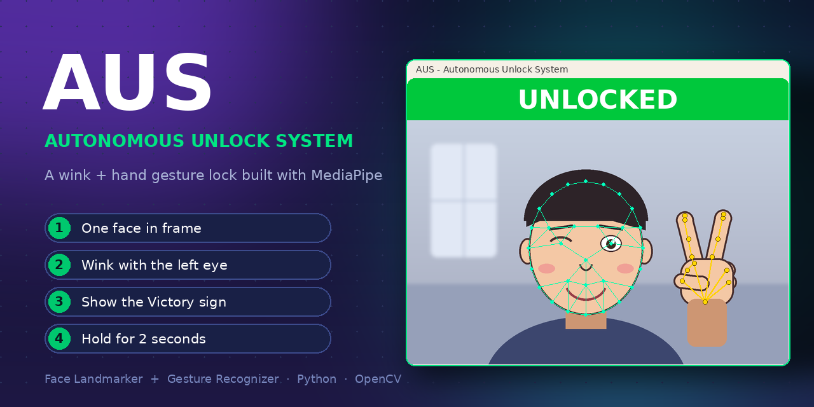
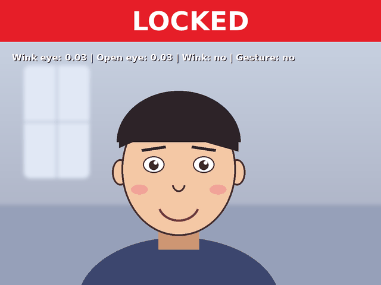
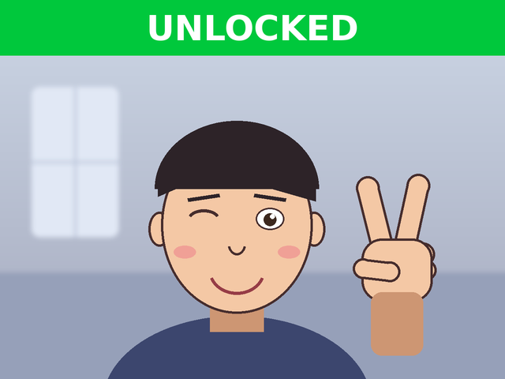

# AUS: Autonomous Unlock System

A computer vision "lock" built with Google MediaPipe. It uses your webcam and only unlocks when it sees the correct combination: **one face in frame, a left-eye wink, and a specific hand gesture, all held for 2 seconds.** Any other combination keeps it locked.

> This is a demo project made for learning MediaPipe Vision tasks. It is not a real security system (see [Limitations](#limitations)).

## Demo





| Locked | Unlocked |
|--------|----------|
|  |  |

## Features

- Runs **two MediaPipe models at the same time** on the same camera frame
- Detects the number of faces and rejects the attempt if there is more than one
- Detects a wink using face blendshape scores
- Recognizes hand gestures (default: Victory / peace sign)
- Lets you keep your other hand in frame without breaking the unlock
- 2 second hold timer with an on-screen progress bar
- Red **LOCKED** / green **UNLOCKED** banner on the camera feed
- Automatically relocks after a few seconds
- Every setting is in one file (`config.py`)

## How it works

Every frame from the webcam goes through this pipeline:

1. **Face Landmarker** returns the number of faces and blendshape scores (how closed each eye is, from 0 to 1).
2. **Gesture Recognizer** returns the gesture of each visible hand.
3. The rules are checked:
   - exactly one face is visible
   - the wink eye is closed and the other eye is open
   - exactly one hand is making the required gesture
4. If all rules pass, a hold timer runs. If any rule breaks, the timer resets.
5. After the pose is held for the required time, the state changes to **UNLOCKED**, then relocks automatically.

Both models run in `LIVE_STREAM` mode, so detection happens in the background and results arrive through callbacks without slowing down the camera feed.

## Project structure

```
.
├── Models/
│   ├── face_landmarker.task
│   └── gesture_recognizer.task
├── app_live.py       # main file: camera loop
├── config.py         # all settings (thresholds, gesture, colors, paths)
├── detectors.py      # creates both models and stores the latest results
├── lock_logic.py     # wink/gesture rules and the lock/unlock state
├── ui.py             # drawing the banner, hint text and progress bar
├── requirements.txt
└── README.md
```

## Requirements

- Python 3.9 to 3.12
- A webcam
- Packages listed in `requirements.txt` (MediaPipe and OpenCV)

## Installation

1. Clone the repository:

   ```bash
   git clone https://github.com/<Ali1Yasser>/AUS-Autonomous-Unlock-System.git
   cd AUS-Autonomous-Unlock-System
   ```

2. Create and activate a virtual environment (recommended):

   ```bash
   python -m venv .venv

   # Windows
   .venv\Scripts\activate

   # macOS / Linux
   source .venv/bin/activate
   ```

3. Install the dependencies:

   ```bash
   pip install -r requirements.txt
   ```

4. Download the two model files and put them in the `Models/` folder:
   - [face_landmarker.task](https://storage.googleapis.com/mediapipe-models/face_landmarker/face_landmarker/float16/1/face_landmarker.task)
   - [gesture_recognizer.task](https://storage.googleapis.com/mediapipe-models/gesture_recognizer/gesture_recognizer/float16/1/gesture_recognizer.task)

## Usage

```bash
python app_live.py
```

**To unlock:** face the camera alone, wink your **left eye**, and show a **Victory** sign with either hand. Hold both for 2 seconds until the banner turns green.

| Key | Action             |
| --- | ------------------ |
| `q` | Quit               |
| `r` | Relock immediately |

## Configuration

All settings are in `config.py`:

| Setting                 | Description                                                                                                           | Default                          |
| ----------------------- | --------------------------------------------------------------------------------------------------------------------- | -------------------------------- |
| `REQUIRED_GESTURE`      | Gesture needed to unlock (`Victory`, `Thumb_Up`, `Open_Palm`, `Closed_Fist`, `Pointing_Up`, `Thumb_Down`, `ILoveYou`) | `Victory`                        |
| `REQUIRED_HAND`         | `None` for either hand, or `"Left"` / `"Right"`                                                                       | `None`                           |
| `HOLD_SECONDS`          | How long the pose must be held                                                                                        | `2.0`                            |
| `UNLOCKED_DURATION`     | Seconds before it relocks automatically                                                                               | `5.0`                            |
| `WINK_CLOSED`           | Wink eye must score above this                                                                                        | `0.3`                            |
| `WINK_OPEN`             | The other eye must score below this                                                                                   | `0.3`                            |
| `GESTURE_MIN_SCORE`     | Minimum gesture confidence                                                                                            | `0.6`                            |
| `WINK_EYE` / `OPEN_EYE` | Which eye winks (swap them if left and right are reversed)                                                            | `eyeBlinkLeft` / `eyeBlinkRight` |

## Troubleshooting

- **The wink is not detected:** print or display the blink scores while winking and adjust `WINK_CLOSED` and `WINK_OPEN`. Good front lighting helps a lot, and glasses can reduce accuracy.
- **Left and right are swapped:** the frame is sent to the models unmirrored, so swap `WINK_EYE` and `OPEN_EYE` (and `REQUIRED_HAND` if you use it).
- **Model file not found:** make sure both `.task` files are inside the `Models/` folder.
- **Camera does not open:** close other apps using the webcam, or change `cv2.VideoCapture(0)` to `1` in `app_live.py`.

## Limitations

This project is a demonstration of MediaPipe Vision tasks and **should not be used to protect anything important**. A photo or video of the correct pose could potentially fool it, and it does not verify who the person is, only what they are doing.

## Future improvements

- Randomize the required gesture each time (challenge-response) to resist replays
- Add a password step before the camera opens
- Encrypt a folder and only decrypt it after a successful unlock
- Log failed attempts with a timestamp and a captured photo
- Add face recognition so only a specific person can unlock

## Built with

- [MediaPipe](https://developers.google.com/mediapipe) (Face Landmarker and Gesture Recognizer)
- [OpenCV](https://opencv.org/)
